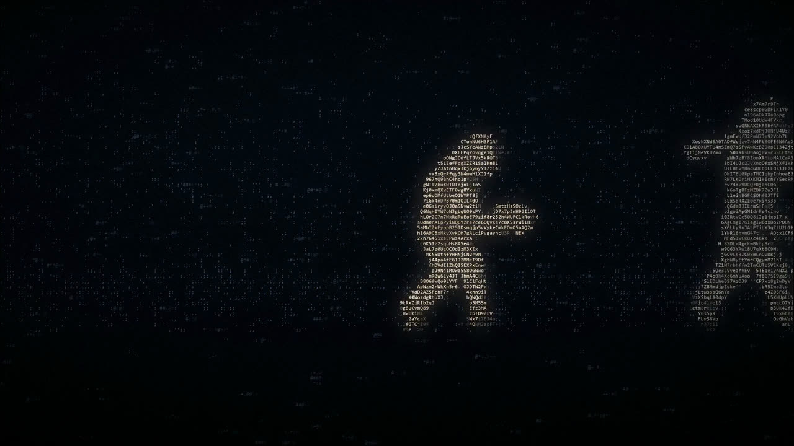
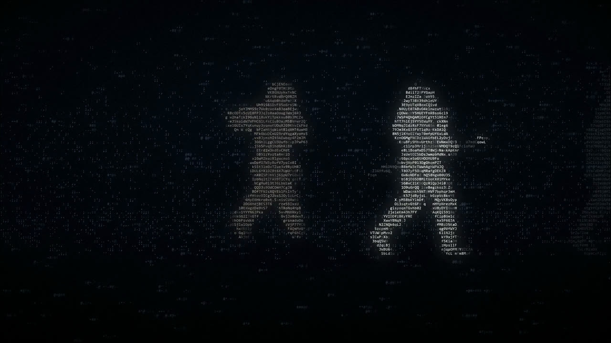
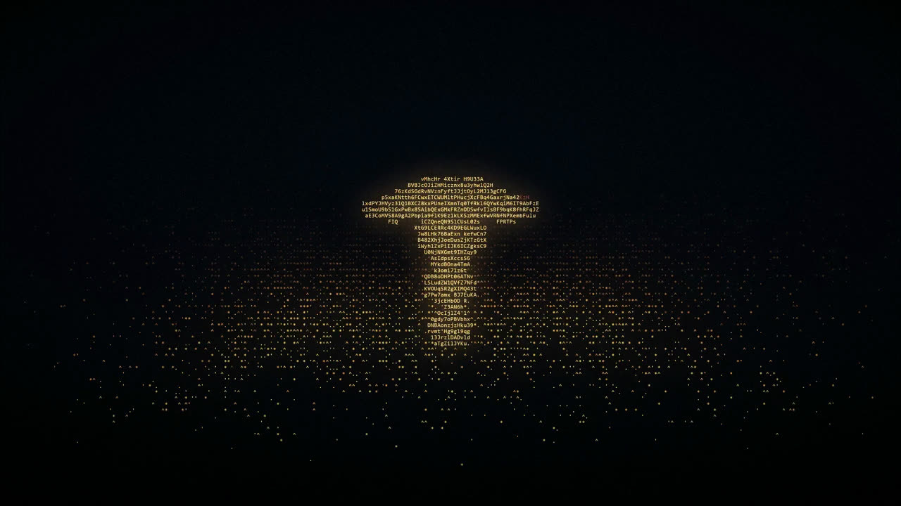

# ascii-film

用 Python 从零渲染的 **32 秒 ASCII 影片**：画面全部由字符点云构成，相机是手写的伪 3D，
七段镜头用「胶片条」模型无缝缝成一条连续镜头。

- 1920×1080 / 30 fps / 960 帧 / 32.000 s
- **0 个剪辑点** —— 整片是一条连续镜头，转场靠相机运动完成，没有一处硬切
- 音频分析与画面逐帧对齐（音轨窗口相关性 0.99993）





> 仓库只含渲染代码与静帧。成片使用了一段受版权保护的音乐，因此视频本身不在此公开；
> 结尾的标题卡未收录，静帧只取前六段。

---

## 管线

```
        音频
         │  频谱 / 能量包络
         ▼
   find_climax.py ──→ 找全曲最响的 3 秒，对齐到凤凰段
         │
         ▼
   参考图 ──→ trace.py ──→ 点云（每个字符格一个样本）
         │
         ▼
   元素渲染（render3d.py + el_*.py）
         │  每段一个 mp4，1.4× 时长留出转场余量
         ▼
   film.py ──→ 胶片条合成
         │  一条时间轴单调右移，相机 = 播放头
         ▼
   ffmpeg ──→ H.264 + AAC
```

### 核心模型：不用时间轴，用一条胶片

常规做法是「七段视频按时间排队，段间加转场」。这里的做法是把七段拼成**一条无限长的胶片**，
一条光标 `c(t)` 从 0 单调右移到末尾，每段的局部坐标是 `local_i = c − X_i`，相机就是播放头本身。

好处：
- 段与段之间**没有「切换」这个动作**，只有「光标走过去了」，所以天然不会出剪辑点
- 转场时长由两段的槽位重叠量（`OVERLAP = 0.8s`）决定，是一个参数而不是一段特效
- 段内相机曲线全部用 `k = t/dur` 归一化，改槽位不影响构图，只影响播放速度

### 伪 3D 相机

`render3d.py` 里的 `Scene3D.camera()` 做透视投影：世界坐标 → 相机空间 → 屏幕。
镜头运动是手写的曲线（推进、绕行、俯仰），不是套滤镜。

一个实测指标：量棱镜中心在画面上的位置，首帧 30.5% → 末帧 61.0%，高度从 392px 涨到 1391px（3.55×）。

> 注意：用「全画面亮像素质心」量会读成 35%→60%，因为白色光束和色散扇形是独立的亮物体。
> 必须只取玻璃层（先按亮度与饱和度筛，再取最大连通域）。

### 字符栅格

画面被切成 `cols × rows` 个格子，每个格子填一个字符 + 一个颜色。
点云按到轮廓的距离决定字符密度 —— 这是整片观感的关键，见下面的坑 1。

---

## 七条真正踩过的坑

### 1. 填满 ≠ 实心

同一套点云，在人体（约 600px 高）上填满是「实心」；在手臂特写（1900px 宽）上填满就是一堵字墙。

大特写必须按**到轮廓的距离**做密度稀释：内部留 20–25% 的概率，不是 100%。

### 2. 衰减权重不能有下限

`inten *= (0.28 + 0.72*fade)` 会让 `fade=0` 的点仍以 28% 亮度画出来 —— 本该死掉的溶解区永远不消失，看起来就是一层雾。

要 `fade ** 0.55`，同时抬高 `keep` 阈值。

### 3. 参考图自己的边界会变成屏幕上的墙

点云沿着原图的裁切线结束时，在画面上就是一条笔直的垂直线。
必须做 `border_fade`（离图边 150px 内线性降到 0）。

### 4. 素材分辨率要 ≥ 栅格列数

489px 的封面映到 274 列，很多字符格一个源像素都没有，人形会变成稀疏点阵。
先 2× LANCZOS 上采样再抠。

### 5. 3D 实体必须有墙面

三角形挤出厚度，但如果只画前后两个面 + 三根细连线，从任何角度看都是平面三角形。
侧墙要铺点阵，并按光束方向给明暗。

### 6. 没有近景层就没有速度

所有物体都在一个深度时，横移读起来是「图在平移」而不是「相机在动」。
加近景尘埃（相机前 0.2–3.4），按 1/深度拉拖影，才有穿过去的感觉。

### 7. 转场不能先淡到黑

先把彩色场淡到 26% 密度再切卡，在成片时间轴上就是**一次黑屏**。
正确做法是让场一直亮着，由下一个镜头「吃掉」它。

---

## 验收方式

每次交片前跑这三条，全部通过才算出片：

```bash
# 1. 剪辑点检测：命中数必须为 0
ffmpeg -i film.mp4 -vf "select='gt(scene,0.30)',metadata=print" -f null -

# 2. 逐帧亮度：不能有黑场
ffmpeg -i film.mp4 -vf "signalstats,metadata=print" -f null - | grep YAVG

# 3. 音画对齐：音轨窗口相关性
python -c "..."   # 见 docs/DESIGN.md
```

实测：YAVG min 22.9 / max 47.2 / mean 29.4；音轨相关性 0.99993；全片最响的 45–48 s 正好落在凤凰段。

## 跑起来

```bash
# 需要先准备 refs/（参考图）和 clouds/（点云）
python trace.py                  # 从 refs 抽点云
python el_touch.py --dur 7       # 渲染单个元素
python film.py                   # 合成全片
```

完整的设计与实现记录在 [`docs/DESIGN.md`](docs/DESIGN.md)。

## 文件

```
elib.py          共用骨架：Grid / Buf / project / compose / run
render3d.py      伪 3D 相机 + 点云投影
film.py          胶片条合成器（镜头表在顶部常量）
el_card.py       07 · 收官卡
el_expel.py      03 · 逐出
el_pact.py       04 · 契约
el_phoenix.py    05 · 涅槃
el_touch.py      02 · 造物
el_wave.py       00 · 浪
march_line.py / march.py / evolve.py / evolve_cloud.py   元素历史版本
trans_t1.py / trans_t57.py                                转场实验
find_climax.py / trace.py                                 音频分析与点云抽取
```
